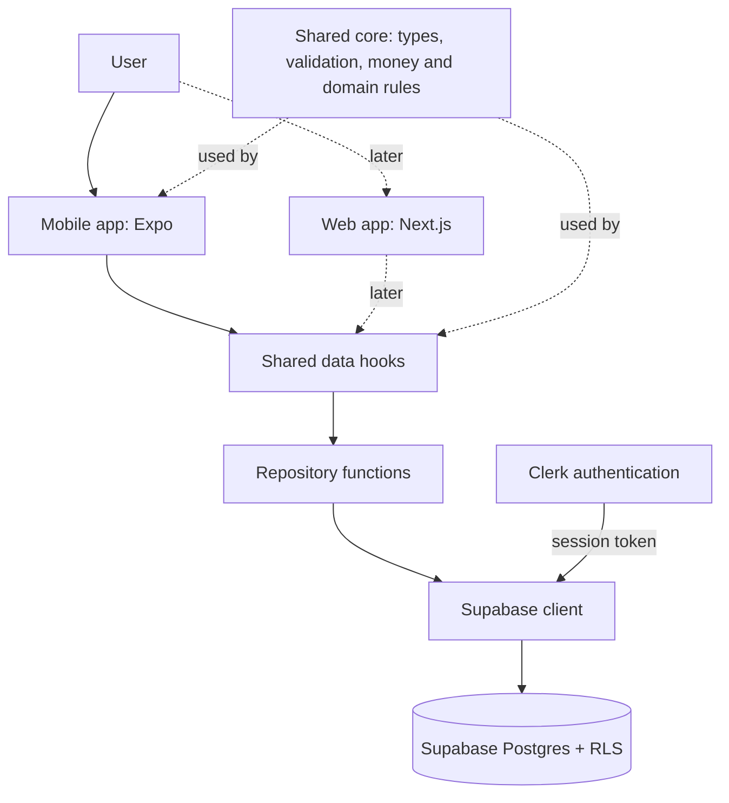

# Balansi: System Architecture

> **Purpose:** describe how Balansi's apps, shared packages, and services fit together.
> **Not here:** product behavior (`PRD.md`), code conventions (`RULES.md`), data invariants (`SCHEMA.md`), or stack rationale (`RECOMMENDED.md`).
> **Status:** Expo app has a Clerk client-side authentication flow and an early Supabase client setup. Planned components below are not implemented unless marked current.
> **Conflict order:** follow `RULES.md`. Record conflicts here rather than silently choosing a design.

---

## 1. Current System

- `apps/mobile` is an Expo SDK 58, React Native, TypeScript app using Expo Router and NativeWind.
- The root Expo Router layout wraps the app in `ClerkProvider` with Clerk's Expo secure token cache. It waits for Clerk to load and routes signed-out users to `(auth)` and signed-in users to `(tabs)`.
- `(auth)/SignIn.tsx` and `(auth)/SignUp.tsx` implement custom email/password screens. Sign-up requires a username and email verification; sign-in includes password reset and supported email, phone, TOTP, and backup-code verification steps. Shared NativeWind UI and validation live in `src/components/auth/AuthUI.tsx`.
- The Settings tab exposes sign-out. The flow requires `EXPO_PUBLIC_CLERK_PUBLISHABLE_KEY`; the app renders a setup message when it is missing.
- Authentication screens are wired, but application data access is not. `apps/mobile/utils/supabase.ts` still creates a Supabase client with AsyncStorage-backed Supabase Auth persistence and does not forward Clerk session tokens.
- `apps/mobile/utils/supabase.ts` creates a Supabase client from `EXPO_PUBLIC_SUPABASE_URL` and `EXPO_PUBLIC_SUPABASE_KEY`, with AsyncStorage configured for Supabase Auth session persistence. It does not yet provide Clerk session tokens to Supabase.
- The Supabase project and Clerk third-party-auth provider are configured externally by the owner; repository migrations and application-level Clerk integration are not present yet.
- The repository is a pnpm workspace. `packages/core`, `packages/data`, `supabase/`, and `apps/web` do not exist yet.
- The product is mobile-first and fully online. Web is a later platform; offline support is out of scope (`PRD.md`).

### Current Repository Structure

```text
.
├── AGENTS.md                       # Shared agent instructions
├── CLAUDE.md                       # Claude entry instructions
├── .agents/skills/                 # Shared installed skills
├── .claude/skills/                 # Claude skill copies and settings
├── .codex/skills/                  # Codex skill copies
├── apps/
│   └── mobile/                     # Expo application
│       ├── AGENTS.md               # Mobile-specific development rules
│       ├── app.json                # Expo app configuration
│       ├── package.json            # Mobile dependencies and scripts
│       ├── global.css               # Tailwind / NativeWind entry point
│       ├── utils/supabase.ts        # Current Supabase client setup
│       └── src/
│           ├── app/
│           │   ├── _layout.tsx     # Clerk provider, auth gate, and root stack
│           │   ├── (auth)/         # Custom sign-in and sign-up screens
│           │   └── (tabs)/         # Signed-in app screens
│           └── components/auth/    # Shared custom auth UI and validation
├── context/
│   ├── ARCHITECTURE.md             # System structure and data flow
│   ├── DESIGN.md                   # Balansi design direction
│   ├── PRD.md                      # Product requirements and feature status
│   ├── RECOMMENDED.md              # Stack rationale and recommendations
│   ├── RULES.md                    # Development conventions
│   ├── SCHEMA.md                   # Proposed data model
│   └── DESIGNS/                    # Design references, tokens, and screen specs
├── package.json                    # Workspace-level scripts
├── pnpm-lock.yaml                  # Locked dependency graph
└── pnpm-workspace.yaml             # Workspace package globs
```

This tree lists the main source and project configuration files; it omits generated files, assets, dependencies, and editor settings. `apps/mobile/assets/` contains Expo app icons and images. The repository has no root `README.md`, `packages/`, `supabase/` migrations, or `apps/web/` at this time.

## 2. Target System



The diagram describes the intended boundaries from `RULES.md`, `SCHEMA.md`, and `RECOMMENDED.md`; it is not a claim about current code.

### Responsibilities

| Component | Responsibility | Status |
|---|---|---|
| `apps/mobile` | Screens, navigation, user interaction, presentation state, and Clerk authentication | Auth flow implemented; data access remains scaffolded |
| `apps/web` | Web UI, if and when the web platform is started | Later; absent |
| `packages/core` | Shared types, Zod validation, money/date helpers, and domain rules; no React or Supabase imports | Planned; absent |
| `packages/data` | Supabase client, repositories, auth adapter, and TanStack Query hooks | Planned; absent |
| Supabase | PostgreSQL, generated API, and RLS | Project configured externally; client utility exists; migrations absent |
| Clerk | User sign-in and identity; user records are not copied into Supabase | Expo provider, secure token cache, custom auth screens, route guard, and sign-out are implemented |

## 3. Request and Data Flow

1. A user signs in through Clerk. The app obtains a Clerk session token for requests to Supabase.
2. Screens use TanStack Query hooks from `packages/data`; screens do not call Supabase directly.
3. Hooks call repository functions in `packages/data`. Repositories own Supabase queries and mutations.
4. Supabase validates the session token and applies Postgres RLS to user-owned rows.
5. Shared input validation and business rules live in `packages/core`; server responses and form input are validated at the appropriate boundary.

This is the documented target, not the current runtime flow. The current client has no Clerk `accessToken` callback, and the app does not yet obtain or forward Clerk session tokens. Add that wiring before treating Supabase requests as Clerk-authenticated; follow current Clerk and Supabase integration documentation.

## 4. Identity and Data Security

- Clerk is the identity provider. Supabase uses Clerk as a third-party auth provider; it does not use Supabase Auth user records (`RULES.md` 7b, `SCHEMA.md`).
- Database `user_id` values are text Clerk user IDs. RLS compares `user_id` to the `sub` claim in the verified JWT.
- Every user-owned table must have RLS policies for reads and writes. Insert and update policies must check the new row's owner.
- References between a user's transaction, category, and account must not cross user boundaries. The schema draft recommends composite `(user_id, id)` foreign keys.
- Never put Clerk secret keys or other third-party secrets in the mobile or web apps.
- Verify third-party auth configuration, JWT claims, and RLS behavior against current provider documentation before implementing policies.

See `SCHEMA.md` for the proposed entities and detailed data invariants.

## 5. Database Changes and Initialization

- Schema changes are versioned in `supabase/migrations/`; do not make manual dashboard changes.
- Until migrations exist, `SCHEMA.md` is the proposed model. Once migrations exist, they define the implemented columns and types.
- Default categories are copied per user. The current documented direction is idempotent, race-safe seeding through a server-side Postgres function called via a repository on first app entry; it is not an auth trigger or webhook (`SCHEMA.md` section 5).
- Monthly reports and totals are derived from transaction data; they are not stored as duplicated totals (`SCHEMA.md`).
- Keep money as integer minor units plus a currency code.

## 6. Feature Organization

Organize by feature as the codebase grows. UI belongs in the relevant app; shared domain logic belongs in `core`; persistence and query hooks belong in `data`. Candidate feature areas are transactions, accounts, and categories, matching the MVP in `PRD.md`.

Naming conventions for feature folders, repositories, hooks, and files are still undecided (`RULES.md`). Avoid creating package or service layers before they are needed.

## 7. Runtime and Operational Constraints

- The app requires connectivity; no offline queue or sync behavior is planned (`PRD.md`).
- Keep transaction lists paginated and index user/date access patterns as queries are implemented (`RULES.md`).
- Use free service tiers only unless the owner approves a paid service (`RULES.md`).
- Expo APIs change across SDK releases. Before changing Expo, EAS, or React Native APIs, follow `apps/mobile/AGENTS.md` and use docs matching the installed SDK major version.

## 8. Unresolved Architecture Decisions

- Whether and when to create `packages/core`, `packages/data`, and Supabase migrations; these are target boundaries, not existing packages.
- Supabase client's Clerk `accessToken` callback and third-party auth/RLS verification. Do not treat Supabase requests as Clerk-authenticated until this is implemented.
- How to test RLS and the Clerk third-party auth setup in local development and CI.
- Whether reports use SQL views or functions; preserve caller RLS in either approach and verify behavior before relying on it.
- File storage, server-side functions, analytics region, and deployment details are not needed for the current MVP implementation and remain undecided where not specified in `RULES.md` or `PRD.md`.

Do not resolve these by inference in feature work. Check the relevant product and rules documents, then record an agreed decision here when one is made.
