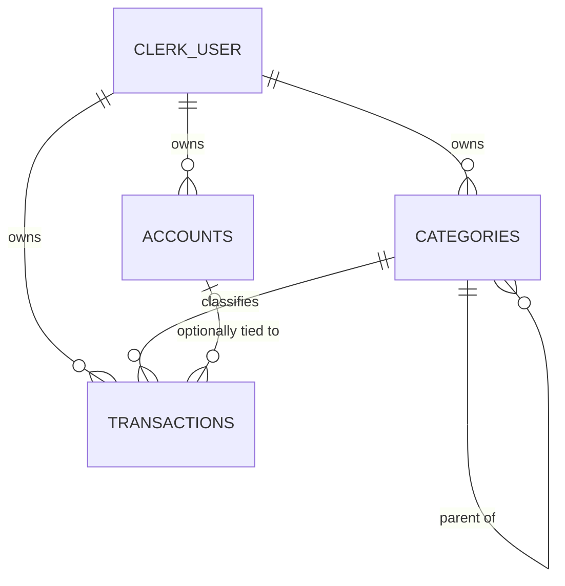

# Balansi: Data Schema (draft)

> **Purpose:** the data model's intent, relationships, and invariants.
> **Authority:** until migrations exist, this file is the design. Once `supabase/migrations/` exists, the migrations win for exact columns and types, and this file keeps only intent, invariants, and RLS rationale. Do not duplicate column lists after that.
> **Status:** draft, all `[proposed]`. Nothing here is built. Requirements live in `PRD.md`; rules in `RULES.md`.
> **Auth:** Clerk, added to Supabase as a third-party auth provider (`RULES.md` 7b). Supabase Auth and `auth.users` are not used.
> **Maintenance:** update only when intent or an invariant changes.

---

## 1. Entities

Relationships only. Columns are in section 2, so they are not repeated here.

`CLERK_USER` is not a table. Users live in Clerk, and rows reference them by the Clerk user ID in `user_id`, with no foreign key. Clerk user records are not synced into Supabase.

Scope matches `PRD.md` F-001 to F-008 and F-011 to F-013. Not modeled yet: debts and urgent payments (F-009), recurring transactions, transfers between accounts, currency conversion. Each is added by a migration when its feature starts.

## 2. Tables `[proposed]`

All tables: `id uuid` primary key, `user_id text` holding the Clerk user ID, `created_at`, `updated_at`.

`user_id` defaults to `(select auth.jwt()->>'sub')`, so inserts do not need to send it, and it has no foreign key.

**accounts**
| Column | Notes |
|---|---|
| `name` | Bank or wallet name, as the user writes it |
| `kind` | `bank` or `wallet` |
| `purpose` | `savings`, `emergency_fund`, `necessities`, `guilt_free`, `investments` |
| `balance_minor` | Integer centavos, entered by hand |
| `currency_code` | Default `PHP` |

**categories**
| Column | Notes |
|---|---|
| `name` | |
| `parent_id` | Null for a category, set for a subcategory |
| `type` | `expense` or `income`; a subcategory has its parent's type |

**transactions**
| Column | Notes |
|---|---|
| `type` | `expense` or `income` |
| `category_id` | Required; its `type` must match |
| `account_id` | Optional `[stated]` |
| `kind` | `actual` or `expected`, for both income and expenses `[stated]` |
| `amount_minor` | Integer centavos, always greater than 0; `type` gives the direction |
| `currency_code` | Default `PHP` |
| `transaction_date` | Date of the transaction, or the date expected. Reports use only the month; the UI does not ask for a precise day |
| `note` | Optional |

The table is named `transactions`, as in `RECOMMENDED.md`, because it holds both income and expenses.

## 3. Invariants

1. Money is integer minor units plus a currency code. Never floats. 1 peso = 100 centavos.
2. Every table has `user_id` (`text`, the Clerk user ID) and RLS enabled. No table is readable without a policy. `[stated]`
3. Past expenses are not a table or flag: they are `actual` expense rows dated in earlier periods.
4. Totals are computed, never stored: monthly total by category, actual vs expected, left over (income minus expenses), and total owned (the sum of `balance_minor`).
5. Categories are one level deep: a subcategory's parent must be a category (`parent_id` null). `[proposed]`
6. A category or account referenced by a transaction must belong to the same user. RLS alone does not guarantee this, because a foreign key check ignores RLS. Recommended fix: composite foreign keys on `(user_id, id)`, which work the same with a `text` `user_id`. `[proposed]`
7. A category with transactions cannot be deleted (restrict, no cascade). `[proposed]`
8. A transaction's category must have the same `type` as the transaction. `[proposed]`
9. Left over counts `actual` rows only. `[stated]`
10. Months and years are derived from `transaction_date`. There is no period table. A month is the calendar month. `[stated]`
11. Calendar deadlines (`PRD.md` F-025) will be added later as a separate nullable `due_date` column or table, not by overloading `transaction_date`. `[proposed]`
12. Deleting a Clerk user does not delete their rows, because there is no foreign key. Account deletion needs its own cleanup path. `[proposed]`

## 4. Row Level Security `[proposed]`

- Identity: the Clerk session token's `sub` claim, read as `(select auth.jwt()->>'sub')`. Wrapping it in `select` lets Postgres evaluate it once per query instead of once per row. `[stated]`
- Intent: a user can select, insert, update, and delete only rows where `user_id` equals that claim.
- Policies apply `to authenticated` only. No policy grants anything to `anon`.
- Insert and update policies must also check the new row's `user_id` (`with check`), so a user cannot write rows for someone else.
- Test with two users: user B must see zero of user A's rows in every table.
- Verify the third-party auth setup and the claim name against current Supabase and Clerk docs before writing the first policy.

## 5. Defaults and Derived Data

- **Default categories:** the list lives in `PRD.md` section 3.1. Each user gets a copy once. There is no trigger on `auth.users`, because Clerk users are not rows in Supabase. `[stated]`
- **Seeding mechanism:** a server-side function that runs on the user's first entry into the app, not a Clerk webhook. `[stated]` Seeding is application data initialization, not an authentication event, and Clerk webhooks are asynchronous with no guarantee of prompt delivery, so onboarding must not wait on one. The app ensures the categories exist, then lets the user proceed.
- **Shape:** `[proposed]` a Postgres function called through a repository in `packages/data`. It runs as the caller, so `user_id` comes from the token's `sub` claim and RLS still applies. An Edge Function is the alternative if the logic outgrows SQL.
- **Idempotent and race-safe:** `[proposed]` a repeated or concurrent call (two devices, a retry) must never duplicate categories. Seeding therefore needs a per-user marker that the function claims atomically, not a check for "no categories yet", because a user may legitimately delete or rename every category later.
- It is added by its own migration and does not block the table migration.
- **Reports:** monthly totals come from a SQL view or function. A view must run with the caller's permissions so RLS still applies; verify this against current Supabase docs before relying on it.

## 6. Indexes `[proposed]`

- `transactions (user_id, transaction_date)`, per `RECOMMENDED.md`.
- Add others only after a real query needs them.

## 7. Open Items

- Where the seeded-once marker lives (section 5): a small per-user table (for example `user_settings` with a `seeded_at` column) is the likely fit, but it adds a table to this schema. Undecided.
- Whether adding a transaction ever adjusts an account balance (`PRD.md` section 6, question 2). The draft assumes not.
- Whether purpose changes need history (question 3). The draft assumes not.
