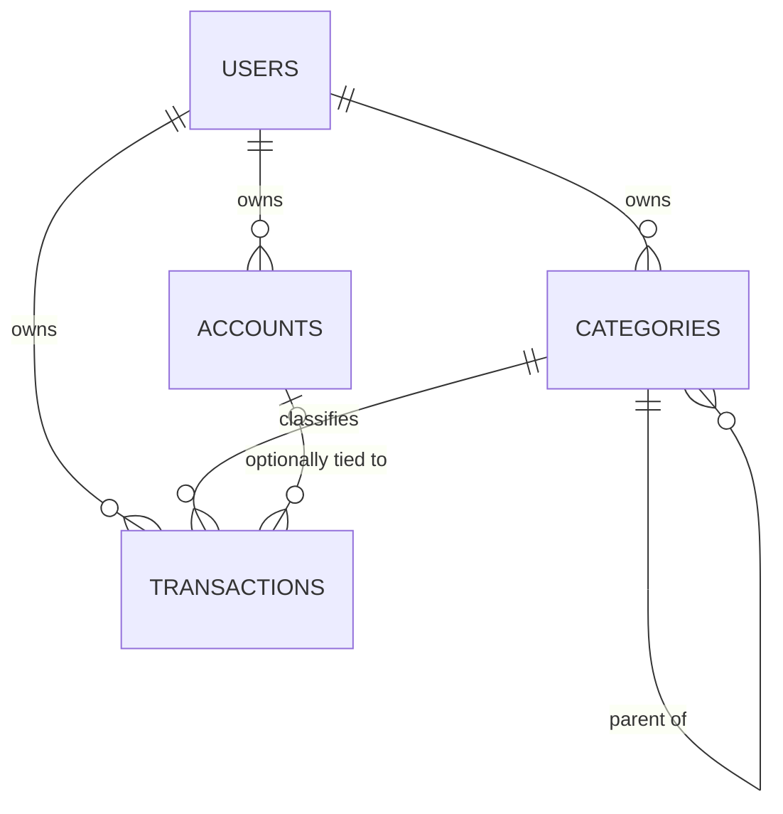

# Balansi: Data Schema (draft)

> **Purpose:** the data model's intent, relationships, and invariants.
> **Authority:** until migrations exist, this file is the design. Once `supabase/migrations/` exists, the migrations win for exact columns and types, and this file keeps only intent, invariants, and RLS rationale. Do not duplicate column lists after that.
> **Status:** draft, all `[proposed]`. Nothing here is built. Requirements live in `PRD.md`; rules in `RULES.md`.
> **Maintenance:** update only when intent or an invariant changes.

---

## 1. Entities

Relationships only. Columns are in section 2, so they are not repeated here.

Scope matches `PRD.md` F-001 to F-008 and F-011 to F-013. Not modeled yet: debts and urgent payments (F-009), recurring transactions, transfers between accounts, currency conversion. Each is added by a migration when its feature starts.

## 2. Tables `[proposed]`

All tables: `id uuid` primary key, `user_id uuid` referencing `auth.users`, `created_at`, `updated_at`.

**accounts**
| Column | Notes |
|---|---|
| `name` | Bank or wallet name, as the user writes it |
| `kind` | `bank` or `wallet` |
| `purpose` | `savings`, `emergency_fund`, `necessities`, `guilt_free`, `investments` |
| `balance_minor` | Integer centavos, entered by hand |
| `currency_code` | Default `PHP` |

**categories**
| Column | Notes |
|---|---|
| `name` | |
| `parent_id` | Null for a category, set for a subcategory |
| `type` | `expense` or `income`; a subcategory has its parent's type |

**transactions**
| Column | Notes |
|---|---|
| `type` | `expense` or `income` |
| `category_id` | Required; its `type` must match |
| `account_id` | Optional `[stated]` |
| `kind` | `actual` or `expected`, for both income and expenses `[stated]` |
| `amount_minor` | Integer centavos, always greater than 0; `type` gives the direction |
| `currency_code` | Default `PHP` |
| `transaction_date` | Date of the transaction, or the date expected. Reports use only the month; the UI does not ask for a precise day |
| `note` | Optional |

The table is named `transactions`, as in `RECOMMENDED.md`, because it holds both income and expenses.

## 3. Invariants

1. Money is integer minor units plus a currency code. Never floats. 1 peso = 100 centavos.
2. Every table has `user_id` and RLS enabled. No table is readable without a policy.
3. Past expenses are not a table or flag: they are `actual` expense rows dated in earlier periods.
4. Totals are computed, never stored: monthly total by category, actual vs expected, left over (income minus expenses), and total owned (the sum of `balance_minor`).
5. Categories are one level deep: a subcategory's parent must be a category (`parent_id` null). `[proposed]`
6. A category or account referenced by a transaction must belong to the same user. RLS alone does not guarantee this, because a foreign key check ignores RLS. Recommended fix: composite foreign keys on `(user_id, id)`. `[proposed]`
7. A category with transactions cannot be deleted (restrict, no cascade). `[proposed]`
8. A transaction's category must have the same `type` as the transaction. `[proposed]`
9. Left over counts `actual` rows only. `[stated]`
10. Months and years are derived from `transaction_date`. There is no period table. A month is the calendar month. `[stated]`
11. Calendar deadlines (`PRD.md` F-025) will be added later as a separate nullable `due_date` column or table, not by overloading `transaction_date`. `[proposed]`

## 4. Row Level Security `[proposed]`

- Intent: a user can select, insert, update, and delete only rows where `user_id` is their own.
- Insert and update policies must also check the new row's `user_id`, so a user cannot write rows for someone else.
- Test with two users: user B must see zero of user A's rows in every table.

## 5. Defaults and Derived Data

- **Default categories:** the list lives in `PRD.md` section 3.1. Each user gets a copy at signup. Recommended mechanism: a database function called by a trigger on new users, defined in a migration. `[proposed]`
- **Reports:** monthly totals come from a SQL view or function. A view must run with the caller's permissions so RLS still applies; verify this against current Supabase docs before relying on it.

## 6. Indexes `[proposed]`

- `transactions (user_id, transaction_date)`, per `RECOMMENDED.md`.
- Add others only after a real query needs them.

## 7. Open Items

- Whether adding a transaction ever adjusts an account balance (`PRD.md` section 6, question 2). The draft assumes not.
- Whether purpose changes need history (question 3). The draft assumes not.
