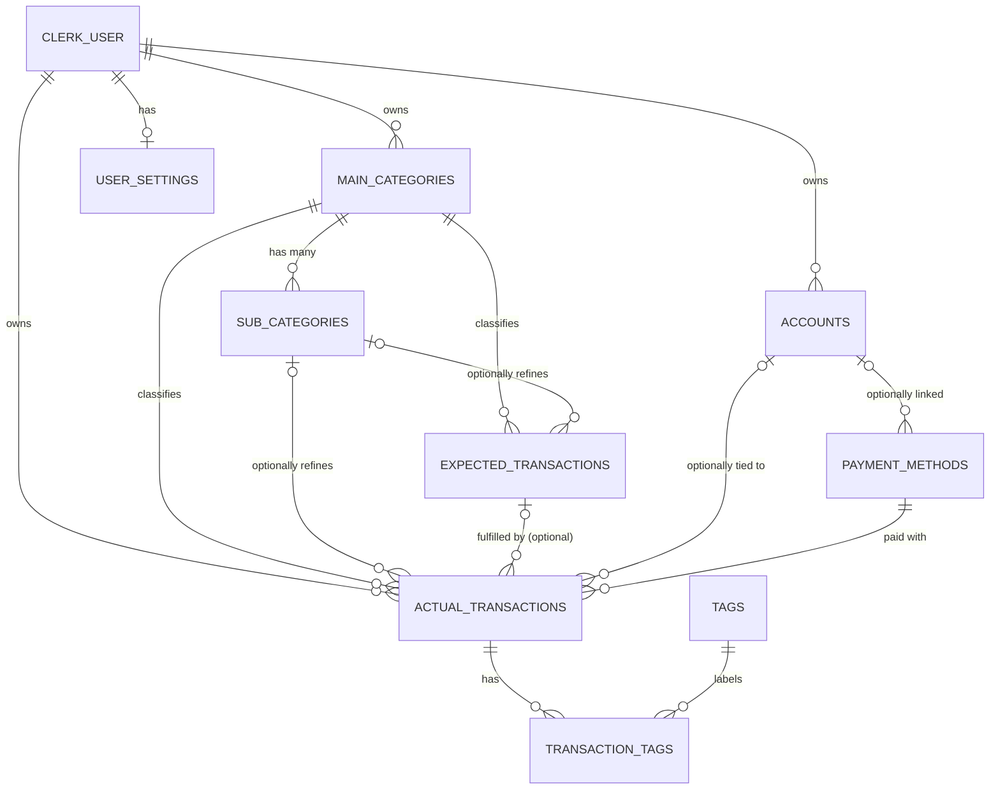

# Balansi: Data Schema (draft)

> **Purpose:** the data model's intent, relationships, and invariants.
> **Authority:** until migrations exist, this file is the design. Once `supabase/migrations/` exists, the migrations win for exact columns and types, and this file keeps only intent, invariants, and RLS rationale. Do not duplicate column lists after that.
> **Status:** draft, all `[proposed]` unless tagged. Nothing here is built. Requirements live in `PRD.md`; rules in `RULES.md`.
> **Diagram:** `balansi-erd.drawio` (open in draw.io). It is the visual copy of section 1. Keep the two in step.
> **Auth:** Clerk, added to Supabase as a third-party auth provider (`RULES.md` 7b). Supabase Auth and `auth.users` are not used.
> **Maintenance:** update only when intent or an invariant changes.

---

## 1. Entities

Relationships only. Columns are in section 2.

`CLERK_USER` is not a table. Users live in Clerk, and rows reference them by the Clerk user ID in `user_id`, with no foreign key. Clerk user records are not synced into Supabase. Every table carries `user_id`; the diagram draws ownership lines for the main tables only.

Derived views (section 5), not tables: `v_actual_income`, `v_actual_expenses`, `v_expected_income`, `v_expected_summary`.

Scope matches `PRD.md` F-001 to F-008, F-011 to F-013, F-015, and F-016. Not modeled yet: debts and urgent payments (F-009), recurring transactions, transfers between accounts, currency conversion. Each is added by a migration when its feature starts.

## 2. Tables

All tables: `id uuid` primary key (except `transaction_tags`), `user_id text` holding the Clerk user ID, `created_at`, `updated_at`.

`user_id` defaults to `(select auth.jwt()->>'sub')`, so inserts do not need to send it, and it has no foreign key.

**accounts** (unchanged) `[stated]`
| Column | Notes |
|---|---|
| `name` | Bank or wallet name, as the user writes it (Savings account, GCash, a bank branch) |
| `kind` | `bank` or `wallet` |
| `purpose` | `savings`, `emergency_fund`, `necessities`, `guilt_free`, `investments` |
| `balance_minor` | Integer centavos, entered by hand |
| `currency_code` | Default `PHP` |

**payment_methods** `[stated]` (Cash, GCash, Bank Branch, and so on)
| Column | Notes |
|---|---|
| `name` | Unique per user `[proposed]` |
| `account_id` | Optional link to the account the method draws from, so GCash the method can point to GCash the wallet `[proposed]` |

**main_categories** `[stated]` (separate from sub categories, by request)
| Column | Notes |
|---|---|
| `name` | Unique per user and type `[proposed]` |
| `type` | `income` or `expense`. A sub category follows its main category's type |

**sub_categories** `[stated]`
| Column | Notes |
|---|---|
| `main_category_id` | Required. One main category has many sub categories |
| `name` | Unique within its main category `[proposed]` |

**actual_transactions** `[stated]` (money that has happened; add and remove)
| Column | Notes |
|---|---|
| `type` | `income` or `expense` |
| `main_category_id` | Required; its `type` must match |
| `sub_category_id` | Optional; must belong to the main category |
| `account_id` | Optional |
| `payment_method_id` | Required when `type` is `expense`; optional for income `[proposed]` |
| `expected_transaction_id` | Optional. The planned entry this one fulfilled `[proposed]` |
| `amount_minor` | Integer centavos, always greater than 0; `type` gives the direction |
| `currency_code` | Default `PHP` |
| `transaction_date` | Date of the transaction. Reports use only the month; the UI does not ask for a precise day |
| `remarks` | Optional description |

**expected_transactions** `[stated]` (planned money, entered by hand)
| Column | Notes |
|---|---|
| `type` | `income` or `expense` |
| `main_category_id` | Required; its `type` must match |
| `sub_category_id` | Optional; must belong to the main category |
| `amount_minor` | Integer centavos, always greater than 0 |
| `currency_code` | Default `PHP` |
| `expected_date` | The date or month expected. Reports use only the month |
| `remarks` | Optional |

Expected rows have no payment method, account, or tags: those belong to a real purchase. `[proposed]`

**tags** `[stated]` (custom labels such as paid, not paid, debt)
| Column | Notes |
|---|---|
| `name` | Unique per user |

**transaction_tags** (join; many tags per actual transaction)
| Column | Notes |
|---|---|
| `actual_transaction_id`, `tag_id` | Composite primary key |
| `user_id` | Needed so RLS can check ownership |

Tags attach to actual rows only. `[proposed]`

**user_settings** `[proposed]`
| Column | Notes |
|---|---|
| `user_id` | Unique; one row per user |
| `seeded_at` | When the default categories were copied (section 5) |

## 3. Invariants

1. Money is integer minor units plus a currency code. Never floats. 1 peso = 100 centavos.
2. Every table has `user_id` (`text`, the Clerk user ID) and RLS enabled. No table is readable without a policy. `[stated]`
3. Actual and expected are separate tables. `[stated]` Past expenses are not a table or flag: they are actual expense rows dated in earlier periods.
4. Totals are computed, never stored: monthly total by category, actual vs expected, left over (actual income minus actual expenses), and total owned (the sum of `balance_minor`).
5. Left over uses `actual_transactions` only. Expected rows never count toward it. `[stated]`
6. Categories are two tables and one level deep: a sub category belongs to exactly one main category. A transaction may reference a main category alone. `[stated]`
7. Every link between a user's rows must stay inside that user. RLS alone does not guarantee this, because a foreign key check ignores RLS. Use composite foreign keys on `(user_id, id)`, which work the same with a `text` `user_id`. `[proposed]`
8. A sub category must belong to the transaction's main category. `sub_categories` has a unique key on `(user_id, main_category_id, id)`, and both transaction tables reference it with `(user_id, main_category_id, sub_category_id)`. When `sub_category_id` is null the check is skipped, which is the intended optional behavior. `[proposed]`
9. A transaction's `type` must equal its main category's `type`. `main_categories` has a unique key on `(user_id, id, type)`, and both transaction tables reference it with `(user_id, main_category_id, type)`. `[proposed]`
10. A main category with sub categories or transactions cannot be deleted. A sub category with transactions cannot be deleted. Restrict, no cascade. `[proposed]`
11. An actual expense must have a `payment_method_id`. A check constraint enforces it. `[proposed]`
12. `expected_transaction_id` must point to an expected row with the same `type` and main category: a composite reference on `(user_id, expected_transaction_id, type, main_category_id)`. One expected row may be fulfilled by many actual rows. `[proposed]`
13. Months and years are derived from `transaction_date` and `expected_date`. There is no period table. A month is the calendar month. `[stated]`
14. Calendar deadlines (`PRD.md` F-025) will be added later as a separate nullable `due_date` column or table, not by overloading the date columns. `[proposed]`
15. Deleting a Clerk user does not delete their rows, because there is no foreign key. Account deletion needs its own cleanup path. `[proposed]`

## 4. Row Level Security `[proposed]`

- Identity: the Clerk session token's `sub` claim, read as `(select auth.jwt()->>'sub')`. Wrapping it in `select` lets Postgres evaluate it once per query instead of once per row. `[stated]`
- Intent: a user can select, insert, update, and delete only rows where `user_id` equals that claim.
- Policies apply `to authenticated` only. No policy grants anything to `anon`.
- Insert and update policies must also check the new row's `user_id` (`with check`), so a user cannot write rows for someone else.
- Test with two users: user B must see zero of user A's rows in every table, including `transaction_tags`.
- Verify the third-party auth setup and the claim name against current Supabase and Clerk docs before writing the first policy.

## 5. Defaults and Derived Data

- **Default categories:** the list lives in `PRD.md` section 3.1. Each user gets a copy once: main categories first, then their sub categories. There is no trigger on `auth.users`, because Clerk users are not rows in Supabase. `[stated]`
- **Seeding mechanism:** a server-side function that runs on the user's first entry into the app, not a Clerk webhook. `[stated]` Seeding is application data initialization, not an authentication event, and Clerk webhooks are asynchronous with no guarantee of prompt delivery, so onboarding must not wait on one. The app ensures the categories exist, then lets the user proceed.
- **Shape:** a Postgres function called through a repository in `packages/data`. It runs as the caller, so `user_id` comes from the token's `sub` claim and RLS still applies. An Edge Function is the alternative if the logic outgrows SQL. `[proposed]`
- **Idempotent and race-safe:** a repeated or concurrent call (two devices, a retry) must never duplicate categories. Seeding needs a per-user marker that the function claims atomically (`user_settings.seeded_at`), not a check for "no categories yet", because a user may legitimately delete or rename every category later. `[proposed]`
- It is added by its own migration and does not block the table migration.
- **Views** `[proposed]`: `v_actual_income` and `v_actual_expenses` filter `actual_transactions` by type; `v_expected_income` and `v_expected_summary` read `expected_transactions`. Each groups by month and category. `v_expected_summary` returns expected income, expected expenses, and expected left over per month. A view must run with the caller's permissions so RLS still applies (`security_invoker`); verify this against current Supabase docs before relying on it.
- **Actual vs expected:** compare the two tables by month and category with a join. No union is needed.

## 6. Indexes `[proposed]`

- `actual_transactions (user_id, transaction_date)`, per `RECOMMENDED.md`.
- `expected_transactions (user_id, expected_date)`.
- Add others only after a real query needs them.

## 7. Open Items

- Whether tags also attach to expected rows (for example "debt" on a planned payment). The draft says actual only.
- Whether "paid" and "not paid" are tags or a status column. With actual and expected split, "not paid" may just mean an entry that is still only expected.
- Whether the `expected_transaction_id` link is in the MVP. The tables work without it.
- "Repeated" income: the draft allows many entries per sub category. Auto-repeating entries are recurring transactions, which `PRD.md` leaves out of the MVP.
- Whether removing a transaction is a hard delete, or a `deleted_at` column lets the user undo it.
- Whether adding a transaction ever adjusts an account balance (`PRD.md` section 6, question 2). The draft assumes not.
- Whether purpose changes need history (question 3). The draft assumes not.
- How `payment_methods` and `accounts` overlap in the UI, since both list GCash and bank names.
